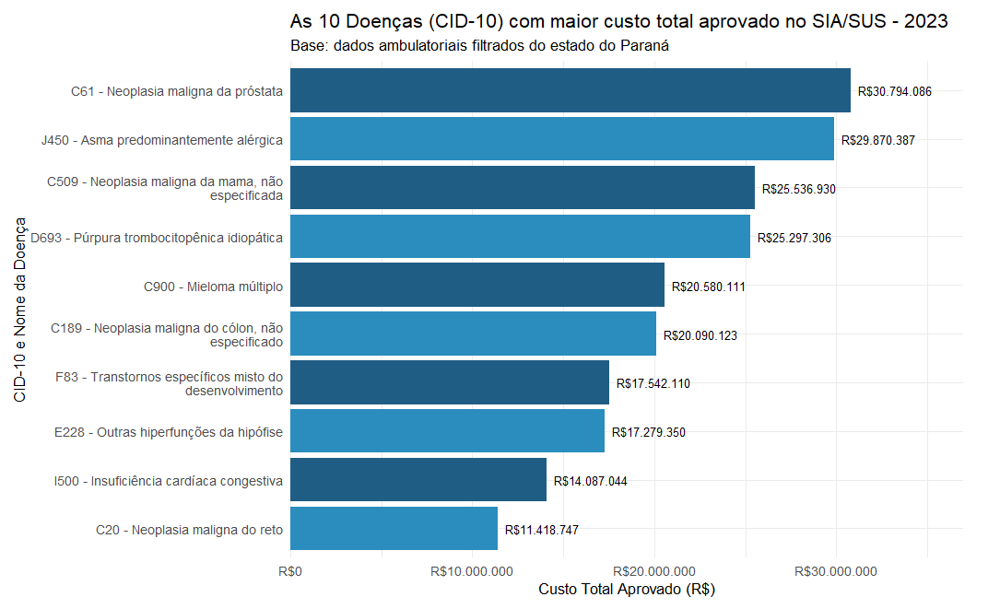

# Mineração de dados no SUS com R

**Análise de dados ambulatoriais do Paraná em 2023: preparação de dados, visualização e aprendizado de máquina.**

Projeto desenvolvido no meu Trabalho de Conclusão de Curso na Universidade Estadual de Ponta Grossa (UEPG), com foco na identificação de padrões de uso de medicamentos, terapias e procedimentos clínicos no SUS.

O trabalho percorre a coleta dos dados públicos, a integração com tabelas de referência, a construção de uma base analítica e a interpretação dos resultados. A base inicial descrita no artigo reúne **40,3 milhões de registros**; após os critérios de preparação e seleção, a base analítica ficou com **4.685.717 registros e 20 variáveis**.

[Leia o artigo completo](docs/artigo-tcc.pdf)

## Problema e objetivo

Como transformar registros administrativos do SUS em informações sobre padrões de atendimento e utilização de recursos?

O objetivo foi explorar procedimentos, diagnósticos, características demográficas e valores aprovados, além de aplicar técnicas de mineração para identificar agrupamentos e associações nos dados. Os resultados oferecem elementos para discussão sobre planejamento e gestão em saúde.

## Dados utilizados

| Item | Descrição |
| --- | --- |
| Fonte principal | Sistema de Informações Ambulatoriais do SUS (SIA/SUS), disponibilizado pelo DATASUS |
| Recorte da base analítica | Paraná, janeiro a dezembro de 2023 |
| Tabelas de referência | SIGTAP e CID-10 |
| Base inicial | 40.335.101 registros e 82 colunas |
| Base analítica final | 4.685.717 registros e 20 variáveis |
| Grupos selecionados | Procedimentos clínicos, medicamentos e ações complementares da atenção à saúde |

Os registros representam informações de produção ambulatorial. Quantidade de registros, quantidade aprovada de procedimentos e número de pacientes únicos são medidas diferentes.

## Tecnologias

| Etapa | Ferramentas utilizadas |
| --- | --- |
| Linguagem e ambiente | R e RStudio |
| Coleta | `microdatasus` |
| Manipulação e preparação | `dplyr`, `tidyr`, `stringr` |
| Visualização | `ggplot2`, `scales` |
| Agrupamento | K-means e `factoextra` |
| Árvore de decisão | `rpart`, `rpart.plot` |
| Regras de associação | `arules` |

## Etapas do trabalho

1. **Coleta e consolidação:** obtenção dos arquivos mensais com `microdatasus`, organização por semestre e consolidação do período. O processamento foi dividido para lidar com limitações computacionais.
2. **Integração:** cruzamento com o SIGTAP para incorporar a classificação dos procedimentos e com a tabela CID-10 para validar os diagnósticos.
3. **Preparação:** seleção dos grupos de interesse, exclusão de CIDs ausentes ou inválidos, remoção de registros fora de 2023 e de colunas sem relevância para a análise. Foram aplicados os critérios do estudo para excluir quantidade aprovada igual a zero e valor aprovado menor ou igual a zero.
4. **Análise exploratória:** investigação de procedimentos e diagnósticos frequentes, distribuição por sexo e idade, evolução mensal e custos aprovados.
5. **Mineração de dados:** aplicação de agrupamento, classificação e regras de associação em recortes e amostras da base.

## Modelagem

| Técnica | Aplicação no estudo |
| --- | --- |
| **K-means** | Amostra de 10 mil registros; idade, sexo e CID-10 convertido em fator numérico; padronização z-score; três clusters definidos com apoio do método do cotovelo. |
| **Árvore de decisão CART** | Predição do procedimento a partir de idade, sexo e CID-10; recorte dos oito CIDs e oito procedimentos mais frequentes; divisão aleatória de 70% para treino e 30% para teste. |
| **Apriori** | Associação entre diagnóstico e procedimento; recorte dos dez CIDs e dez procedimentos mais frequentes; aproximadamente 300 mil transações após amostragem; análise de suporte, confiança e lift. |

## Resultados apresentados no TCC

- **Três agrupamentos exploratórios** com diferentes distribuições de idade, sexo e diagnóstico na amostra utilizada pelo K-means.
- **Associação entre o CID M545 e atendimento fisioterapêutico**, com lift de aproximadamente **20,6** no recorte analisado pelo Apriori.
- **Análise de custos por diagnóstico:** o CID C61 apresentou cerca de **R$ 30,79 milhões** em valores aprovados, seguido do CID J45.0, com aproximadamente **R$ 29,87 milhões**, conforme os valores exibidos na Figura 8.

*Figura 8 do artigo original, página 11. Fonte indicada no artigo: o autor. Valores referentes ao recorte do estudo.*

## Competências demonstradas

- Coleta e preparação de dados públicos em R.
- Integração de fontes e validação de códigos com tabelas de referência.
- Organização do processamento de milhões de registros sob restrições de recursos computacionais.
- Análise exploratória e comunicação de resultados por gráficos.
- Aplicação e interpretação de diferentes técnicas de mineração de dados.
- Documentação da metodologia e discussão dos resultados em um trabalho acadêmico.

## Escopo e limitações

Os resultados acima são os reportados no TCC; esta apresentação não corresponde a uma nova execução das análises. O recorte geográfico, temporal e os filtros aplicados delimitam sua interpretação. As associações identificadas não estabelecem causalidade nem demonstram, por si só, desperdício ou economia de recursos.

Os modelos utilizaram amostras ou categorias selecionadas. Os agrupamentos são exploratórios, e a codificação numérica de CID-10 merece atenção na interpretação das distâncias do K-means. O percentual de 83% mencionado no artigo refere-se a um nó da árvore de decisão e não deve ser apresentado como acurácia global no conjunto de teste.

Esta versão reúne o resumo do projeto, uma figura de resultados e o artigo completo. Os scripts originais e as bases de dados ainda não estão incluídos; a reprodução computacional depende da disponibilização desses materiais e da documentação do ambiente e dos parâmetros de execução.

## Artigo e autoria

**Título:** Mineração de dados no SUS: padrões de uso de medicamentos e terapias na saúde pública.

**Autoria do artigo:** Diego Luiz Oliveira e Maria Salete Marcon Gomes Vaz, vinculados à UEPG.

O [artigo completo em PDF](docs/artigo-tcc.pdf) apresenta a metodologia, os gráficos, a discussão e as referências utilizadas.
